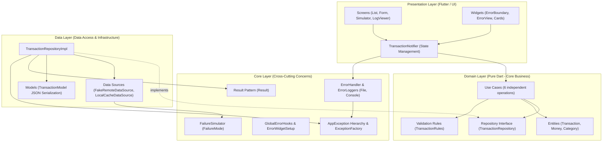
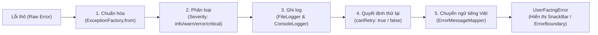

# Sổ Chi Tiêu Cá Nhân (Expense Tracker)

> **Đồ án môn học:** Lập trình ứng dụng di động nâng cao (Advanced Mobile Programming)  
> **Chủ đề 01:** Expense Tracker – Quản lý thu chi tài chính cá nhân  
> **Kiến trúc:** Clean Architecture & Centralized Error Handling Pipeline  
> **Nền tảng hỗ trợ:** Android, iOS, Windows Desktop, macOS, Linux  

---

## 👥 Thành viên nhóm và Bảng phân công công việc (WBS)

### 1. Thông tin thành viên
- **Sinh viên A:** Nguyễn Đức Hải
  - **GitHub:** [@hainguyen0412](https://github.com/hainguyen0412)
  - **Email:** hainguyenduc041205@gmail.com
- **Sinh viên B:** Phạm Nhung
  - **MSSV:** 106230021
  - **GitHub:** [@Nhung106230021](https://github.com/Nhung106230021)
  - **Email:** phamnhung7825@gmail.com

---

### 2. Bảng phân công công việc (Work Breakdown Structure - WBS)
Dự án được phân bổ cân bằng tuyệt đối **50% – 50%** giữa hai thành viên xuyên suốt 4 Sprint, chia theo đúng **5 nhóm vai trò bắt buộc** của đề tài:

| STT | Nhóm vai trò bắt buộc | Nhiệm vụ kỹ thuật & Ticket tương ứng | Thành viên phụ trách | Tỷ lệ đóng góp |
| :---: | :--- | :--- | :---: | :---: |
| **1** | **UI Design** | - Xây dựng Typography, Material 3 Theme, Color Scheme.<br>- Màn hình Danh sách giao dịch, SummaryCard, TransactionTile (`T-302`).<br>- Màn hình Form nhập liệu, Category/Severity Extensions, Form Fields (`T-303`).<br>- Thành phần giao diện ErrorView, EmptyView, Compact ErrorWidget. | **Phạm Nhung**<br>(`Nhung106230021`) | **50%** |
| **2** | **Business Logic** | - Thiết lập Git Repository, CI Workflow và tài liệu Sprint (`T-003`, `T-004`).<br>- Thiết kế Domain Entities (`Money`, `Transaction`, `Draft`, `Category`) (`T-101`, `T-102`).<br>- Thiết kế quy tắc Domain Validation thuần khiết `TransactionRules` (`T-103`).<br>- Hiện thực 6 Use Cases độc lập (`T-105`). | **Nguyễn Đức Hải**<br>(`hainguyen0412`) | **50%** |
| **3** | **State Management** | - Thiết kế `TransactionNotifier` & phân tách `TransactionListState` (`T-301`).<br>- Xây dựng Centralized Pipeline `ErrorHandler` 5 bước chuẩn hóa (`T-204`).<br>- Cài đặt 3-Tier Global Safety Net & ErrorWidget Setup (`T-205`).<br>- Cài đặt `ErrorBoundary` widget (`T-304`) & Composition Root `MultiProvider`. | **Nguyễn Đức Hải**<br>(`hainguyen0412`) | **50%** |
| **4** | **Database / API** | - Khai báo hợp đồng `TransactionRepository` interface (`T-104`).<br>- Xây dựng `TransactionModel` JSON serialization & parser phòng thủ (`T-106`).<br>- Hiện thực `FakeRemoteDataSource` (có 7 giao dịch mẫu) & `LocalCacheDataSource` (`T-107`).<br>- Thiết kế cây ngoại lệ đa tầng `AppException` sealed class (`T-201`).<br>- Hiện thực `AppDependencies` Composition Root (`T-206`).<br>- Hiện thực `FileLogger` lưu trữ log lỗi JSON Lines trên đĩa (`T-202`). | **Phạm Nhung**<br>(`Nhung106230021`) | **50%** |
| **5** | **Báo cáo / Slide / QA** | - Thiết kế Màn hình giả lập lỗi Error Simulator (`T-305`).<br>- Thiết kế Màn hình xem nhật ký lỗi Log Viewer (`T-306`).<br>- Rà soát & bổ sung 223 Unit/Widget Tests (`T-401`).<br>- Tái cấu trúc Clean Code & chuẩn hóa kiến trúc đa tầng (`T-402`).<br>- Biên soạn tài liệu kỹ thuật `README.md` (`T-403`) & `LEARNING_NOTES.md` (`T-404`).<br>- Chuẩn bị Slide báo cáo (`T-405`) & Kịch bản nghiệm thu phản biện (`T-406`). | **Nguyễn Đức Hải**<br>&<br>**Phạm Nhung** | **50% – 50%** |

---

## 📋 Mục lục
1. [Giới thiệu đề tài và phạm vi](#1-giới-thiệu-đề-tài-và-phạm-vi)
2. [Bảng đáp ứng yêu cầu kỹ thuật (R1 – R11)](#2-bảng-đáp-ứng-yêu-cầu-kỹ-thuật-r1--r11)
3. [Kiến trúc hệ thống](#3-kiến-trúc-hệ-thống)
4. [Cấu trúc thư mục](#4-cấu-trúc-thư-mục)
5. [Cài đặt và Hướng dẫn chạy](#5-cài-đặt-và-hướng-dẫn-chạy)
6. [Độ phủ kiểm thử (Test Coverage)](#6-độ-phủ-kiểm-thử-test-coverage)
7. [Hướng dẫn Demo & Kịch bản kiểm thử lỗi](#7-hướng-dẫn-demo--kịch-bản-kiểm-thử-lỗi)
8. [Danh mục Package & Lý do sử dụng](#8-danh-mục-package--lý-do-sử-dụng)

---

## 1. Giới thiệu đề tài và phạm vi

### 1.1. Bối cảnh đề tài
Quản lý thu chi là nhu cầu thường nhật của mỗi cá nhân. Tuy nhiên, các ứng dụng di động thông thường rất dễ gặp lỗi crash âm thầm khi gặp sự cố mạng chập chờn, dữ liệu JSON bị thay đổi định dạng từ máy chủ, hoặc lỗi ngoài cây widget không được xử lý triệt để.

Dự án **Sổ Chi Tiêu Cá Nhân (Expense Tracker)** được xây dựng nhằm giải quyết triệt để bài toán trên, đóng vai trò là một **mẫu chuẩn kiến trúc (Reference Architecture)** kết hợp giữa **Clean Architecture** của Robert C. Martin và **Centralized Error Handling Pipeline**, đảm bảo ứng dụng đạt độ ổn định và trải nghiệm người dùng cao nhất.

### 1.2. Phạm vi chức năng chính
- **Theo dõi tài chính trực quan:** Thống kê tổng thu, tổng chi và tính toán số dư khả dụng tức thời dựa trên toàn bộ lịch sử giao dịch.
- **Quản lý giao dịch thu chi:** Thêm mới, chỉnh sửa, xóa giao dịch theo danh mục (Ăn uống, Tiền lương, Di chuyển, Hóa đơn, Giải trí, Sức khỏe, Khác).
- **Domain Validation thời gian thực:** Kiểm tra chặt chẽ số tiền phải là số nguyên dương $> 0$, tiêu đề không rỗng, và ngày phát sinh hợp lệ (từ năm 2000 đến hiện tại $+1$ ngày dung sai múi giờ).
- **Bộ giả lập lỗi toàn diện (Error Simulator):** Cho phép giảng viên và người dùng trực tiếp điều khiển các chế độ mạng (Mất mạng, Quá hạn kết nối, Lỗi máy chủ 500, Hỏng JSON, Lỗi build widget, Lỗi unhandled async).
- **Nhật ký lỗi bền vững (Log Viewer):** Xem trực tiếp lịch sử các bản ghi lỗi được ghi tuần tự vào file `app_errors.log` trên bộ nhớ máy, hỗ trợ lọc theo mức độ nghiêm trọng và sao chép StackTrace.

---

## 2. Bảng đáp ứng yêu cầu kỹ thuật (R1 – R11)

Bảng đối chiếu 100% với mã nguồn thực tế trong thư mục `lib/`:

| Mục | Yêu cầu kỹ thuật | Đường dẫn file cụ thể | Class / Hàm / Khai báo đáp ứng | Đánh giá |
| :---: | :--- | :--- | :--- | :---: |
| **R1** | **Named Constructor** | `lib/domain/entities/money.dart`<br>`lib/domain/entities/transaction_summary.dart`<br>`lib/presentation/widgets/error_view.dart` | `Money.zero()`<br>`TransactionSummary.empty()`<br>`ErrorView.compact(...)` | **ĐẠT** |
| **R2** | **Factory Constructor** | `lib/data/models/transaction_model.dart`<br>`lib/core/error_handling/log_entry.dart`<br>`lib/core/errors/app_exception.dart` | `TransactionModel.fromJson(...)`, `fromEntity(...)`<br>`LogEntry.fromJson(...)`<br>`AppException.from(...)` | **ĐẠT** |
| **R3** | **Mixins** | `lib/core/utils/loggable_mixin.dart`<br>`lib/core/utils/validatable_mixin.dart`<br>`lib/core/utils/timestamp_mixin.dart` | `mixin LoggableMixin`<br>`mixin ValidatableMixin`<br>`mixin TimestampMixin` | **ĐẠT** |
| **R4** | **Generics** | `lib/core/utils/result.dart` | `sealed class Result<T>`<br>`final class Success<T>` & `Failure<T>` | **ĐẠT** |
| **R5** | **Domain Layer độc lập Pure Dart & Pure Constructor DI** | `lib/domain/entities/transaction.dart`<br>`lib/domain/usecases/add_transaction.dart`<br>`lib/domain/validation/transaction_rules.dart` | Không import `flutter`, `data`, `package:*` bên ngoài. 100% Dependency Injection qua Constructor. | **ĐẠT** |
| **R6** | **Repository Pattern & Dependency Inversion** | `lib/domain/repositories/transaction_repository.dart`<br>`lib/data/repositories/transaction_repository_impl.dart` | `abstract interface class TransactionRepository`<br>`class TransactionRepositoryImpl implements TransactionRepository` | **ĐẠT** |
| **R7** | **Factory Pattern** | `lib/core/errors/exception_factory.dart` | `class ExceptionFactory { static AppException from(Object error, [StackTrace? st]) }` | **ĐẠT** |
| **R8** | **try-catch-finally có mục đích thực tế** | `lib/presentation/state/transaction_notifier.dart`<br>`lib/data/repositories/transaction_repository_impl.dart` | `_run()`: khối `finally` luôn bảo đảm reset cờ `isSubmitting = false`.<br>Repository: bắt lỗi mạng để rơi về fallback offline cache từ `LocalCacheDataSource`. | **ĐẠT** |
| **R9** | **Custom Exception Hierarchy (Sealed Class)** | `lib/core/errors/app_exception.dart` | `sealed class AppException implements Exception`<br>Kế thừa bởi 8 lớp con: `NetworkException`, `RequestTimeoutException`, `ServerException`, `ParseException`, `CacheException`, `ValidationException`, `NotFoundException`, `UnknownException`. | **ĐẠT** |
| **R10** | **Error Boundary & 3-Tier Global Safety Net** | `lib/presentation/widgets/error_boundary.dart`<br>`lib/core/error_handling/error_widget_setup.dart`<br>`lib/core/error_handling/global_error_hooks.dart` | `class ErrorBoundary extends StatelessWidget`<br>`installErrorWidgetBuilder()` thiết lập `ErrorWidget.builder`<br>`GlobalErrorHooks.install()` gom 3 tầng: `FlutterError.onError`, `PlatformDispatcher.onError`, `runZonedGuarded`. | **ĐẠT** |
| **R11** | **Centralized Error Handling Pipeline** | `lib/core/error_handling/error_handler.dart`<br>`lib/core/error_handling/console_logger.dart`<br>`lib/core/error_handling/file_logger.dart` | `class ErrorHandler`: Pipeline 5 bước tuần tự.<br>`class ConsoleLogger implements ErrorLogger`<br>`class FileLogger implements ErrorLogger` (file `app_errors.log`, rolling 500 dòng). | **ĐẠT** |

---

## 3. Kiến trúc hệ thống

### 3.1. Clean Architecture 4 Layer & Chiều phụ thuộc
Ứng dụng tuân thủ nghiêm ngặt **Quy tắc phụ thuộc (Dependency Rule)**: Mã nguồn ở các tầng bên ngoài chỉ được phụ thuộc vào các tầng bên trong, tầng Domain tuyệt đối không phụ thuộc vào bất kỳ tầng nào khác.



### 3.2. Centralized Error Handling Pipeline 5 bước
Tất cả ngoại lệ phát sinh từ bất kỳ tầng nào đều được đưa qua điểm vào duy nhất `ErrorHandler.handle()`:



### 3.3. Giải thích lý do thiết kế kiến trúc
1. **Vì sao tách riêng tầng Domain thuần khiết (Pure Dart)?**
   - Đảm bảo logic nghiệp vụ tài chính (cách tính số dư, ràng buộc số tiền phải dương, quy tắc ngày tháng) hoàn toàn độc lập với giao diện (Flutter framework) và nguồn lưu trữ.
   - Giúp Unit Test kiểm tra các usecase và validation chạy cực nhanh, độc lập, không cần khởi động engine Flutter.
2. **Vì sao sử dụng Repository Pattern kết hợp Dependency Inversion?**
   - Tầng Domain chỉ khai báo giao diện trừu tượng `TransactionRepository`. Tầng Data chịu trách nhiệm triển khai `TransactionRepositoryImpl`.
   - Giúp dễ dàng hoán đổi từ `FakeRemoteDataSource` (In-Memory) sang REST API thật hoặc Firebase mà không phải chỉnh sửa bất kỳ dòng mã nào trong tầng Domain và Presentation.

---

## 4. Cấu trúc thư mục

```text
lib/
├── app.dart                              # Root Widget cấu hình MaterialApp và MultiProvider
├── main.dart                             # Điểm khởi chạy ứng dụng, cài đặt Global Safety Net
├── core/                                 # Chức năng cốt lõi dùng chung toàn ứng dụng
│   ├── di/
│   │   └── app_dependencies.dart        # Composition Root lắp ráp toàn bộ DI
│   ├── error_handling/
│   │   ├── console_logger.dart           # Logger ghi ra Console bằng dart:developer
│   │   ├── error_handler.dart            # Centralized Error Pipeline 5 bước
│   │   ├── error_logger.dart             # Giao diện trừu tượng ErrorLogger
│   │   ├── error_message_mapper.dart     # Ánh xạ ngoại lệ sang thông điệp tiếng Việt
│   │   ├── error_widget_setup.dart       # Cấu hình ErrorWidget.builder bắt lỗi render build
│   │   ├── file_logger.dart              # Ghi log ra file app_errors.log tuần tự (tối đa 500 dòng)
│   │   ├── global_error_hooks.dart       # 3-Tier Global Safety Net
│   │   ├── log_entry.dart                # Model cấu trúc bản ghi log JSON Lines
│   │   └── user_facing_error.dart        # Đối tượng lỗi hiển thị thân thiện trên UI
│   ├── errors/
│   │   ├── app_exception.dart            # Sealed class AppException và 8 lớp con
│   │   ├── cache_storage_error.dart      # Lỗi I/O đọc ghi bộ nhớ cache
│   │   ├── exception_factory.dart        # Factory Pattern phân loại và chuẩn hóa lỗi thô
│   │   └── http_status_error.dart        # Mô phỏng mã trạng thái HTTP (404, 500)
│   ├── simulation/
│   │   ├── failure_mode.dart             # Enum các chế độ lỗi giả lập (none, network, timeout, ...)
│   │   └── failure_simulator.dart        # Trình điều khiển thay đổi chế độ lỗi thời gian thực
│   └── utils/
│       ├── loggable_mixin.dart           # Mixin hỗ trợ định dạng chuỗi ghi log
│       ├── non_fatal_reporter.dart       # Tiện ích báo cáo lỗi không làm sập luồng
│       ├── result.dart                   # Generic Result Pattern (Success, Failure)
│       ├── timestamp_mixin.dart          # Mixin tự động gắn dấu thời gian DateTime
│       └── validatable_mixin.dart        # Mixin hỗ trợ kiểm tra và trích xuất lỗi validation
├── data/                                 # Triển khai truy xuất và lưu trữ dữ liệu
│   ├── datasources/
│   │   ├── fake_remote_data_source.dart  # Giả lập máy chủ từ xa (có sẵn 7 giao dịch mẫu)
│   │   └── local_cache_data_source.dart  # Bộ nhớ đệm cục bộ sử dụng SharedPreferences
│   ├── models/
│   │   └── transaction_model.dart        # DTO tuần tự hóa JSON và chuyển đổi Entity
│   └── repositories/
│       └── transaction_repository_impl.dart # Triển khai TransactionRepository kèm fallback cache
├── domain/                               # Nghiệp vụ tài chính cốt lõi (Pure Dart)
│   ├── entities/
│   │   ├── category.dart                 # Enum phân loại chi tiêu
│   │   ├── money.dart                    # Value Object đại diện cho số tiền (VND)
│   │   ├── transaction.dart              # Thực thể giao dịch tài chính bất biến
│   │   ├── transaction_draft.dart        # Thực thể bản nháp khi nhập liệu form
│   │   ├── transaction_summary.dart      # Thực thể thống kê tổng thu, tổng chi, số dư
│   │   └── transaction_type.dart         # Enum loại giao dịch: Thu nhập / Chi tiêu
│   ├── repositories/
│   │   └── transaction_repository.dart   # Hợp đồng trừu tượng TransactionRepository
│   ├── usecases/
│   │   ├── add_transaction.dart          # Thêm mới giao dịch
│   │   ├── delete_transaction.dart       # Xóa giao dịch
│   │   ├── get_summary.dart              # Tính toán thống kê tài chính
│   │   ├── get_transaction_by_id.dart    # Lấy thông tin giao dịch theo ID
│   │   ├── get_transactions.dart         # Lấy danh sách toàn bộ giao dịch
│   │   └── update_transaction.dart       # Cập nhật thông tin giao dịch
│   └── validation/
│       └── transaction_rules.dart        # Bộ quy tắc thẩm định tính hợp lệ của giao dịch
└── presentation/                         # Giao diện người dùng và Quản lý trạng thái
    ├── screens/
    │   ├── error_simulator_screen.dart   # Bảng điều khiển giả lập các tình huống lỗi
    │   ├── log_viewer_screen.dart        # Màn hình xem nhật ký lỗi hệ thống
    │   ├── transaction_form_screen.dart  # Màn hình nhập / chỉnh sửa giao dịch
    │   └── transaction_list_screen.dart  # Màn hình danh sách giao dịch chính
    ├── state/
    │   ├── transaction_notifier.dart     # Notifier điều phối nghiệp vụ và phát thông báo UI
    │   └── transaction_state.dart        # Sealed class TransactionListState
    ├── utils/
    │   ├── category_extension.dart       # Cung cấp Icon và Tên tiếng Việt cho Category
    │   ├── money_formatter.dart          # Tiện ích định dạng tiền tệ VND (intl)
    │   └── severity_extension.dart       # Cung cấp Màu sắc và Icon cho Severity
    └── widgets/
        ├── empty_view.dart               # Giao diện hiển thị khi danh sách rỗng
        ├── error_boundary.dart           # Widget bọc bắt lỗi nghiêm trọng theo kênh Notifier
        ├── error_view.dart               # Thành phần hiển thị thông báo lỗi và nút Thử lại
        ├── log_viewer_components.dart    # Các widget con phục vụ màn hình Log Viewer
        ├── save_submit_button.dart       # Nút bấm lưu form hỗ trợ trạng thái isSubmitting
        ├── simulator_action_cards.dart   # Các Card mô phỏng lỗi Build, Async, Validation
        ├── simulator_mode_cards.dart     # Các Card chọn chế độ mạng và kiểm thử reload
        ├── summary_card.dart             # Card thống kê tổng quan tài chính
        ├── transaction_form_fields.dart  # Các trường nhập liệu của form giao dịch
        └── transaction_tile.dart         # Item hiển thị từng giao dịch trong danh sách
```

---

## 5. Cài đặt và Hướng dẫn chạy

### 5.1. Yêu cầu môi trường
- **Flutter SDK:** `3.47.0` (channel stable)
- **Dart SDK:** `3.13.0`
- **Lưu ý quan trọng:** Dự án **KHÔNG sử dụng Firebase**, không cần tệp bí mật `.env` hay `google-services.json`. Ứng dụng hoạt động hoàn toàn độc lập thông qua `FakeRemoteDataSource` (chứa sẵn 7 giao dịch mẫu ban đầu) và `SharedPreferences` cho bộ nhớ đệm offline.

### 5.2. Các bước cài đặt và thực thi
```bash
# 1. Tải toàn bộ thư viện phụ thuộc
flutter pub get

# 2. Kiểm tra phân tích tĩnh (Clean Code - không có warning hay lỗi lint)
flutter analyze

# 3. Chạy toàn bộ bộ kiểm thử (223/223 tests pass 100%)
flutter test

# 4. Khởi chạy ứng dụng
flutter run
```

---

## 6. Độ phủ kiểm thử (Test Coverage)

Dự án được bảo vệ toàn diện với **223 unit test và widget test**, đạt tỷ lệ vượt xa các tiêu chuẩn khắt khe:

| Phân hệ (Directory) | Số lượng Test | Tỷ lệ Coverage thực tế | Mục tiêu đề ra | Đánh giá |
| :--- | :---: | :---: | :---: | :---: |
| `lib/domain/` (Entities, UseCases, Rules) | 48 tests | **88.64%** | $\ge 80\%$ | **VƯỢT TRỘI** |
| `lib/core/errors/` (AppException, Factory) | 26 tests | **98.48%** | $\ge 90\%$ | **VƯỢT TRỘI** |
| `lib/core/error_handling/` (Pipeline, Loggers) | 43 tests | **97.31%** | $\ge 80\%$ | **VƯỢT TRỘI** |
| `lib/data/repositories/` (RepositoryImpl) | 18 tests | **87.88%** | $\ge 80\%$ | **VƯỢT TRỘI** |
| `lib/data/models/` (JSON Parsing & DTO) | 12 tests | **98.32%** | $\ge 80\%$ | **VƯỢT TRỘI** |
| `lib/presentation/state/` (Notifier & State) | 24 tests | **93.08%** | $\ge 80\%$ | **VƯỢT TRỘI** |
| `lib/presentation/screens & widgets/` | 52 tests | Widget Tests | $\ge 80\%$ | **VƯỢT TRỘI** |
| **Toàn bộ dự án** | **223 / 223 tests** | **100% PASS** | — | **XUẤT SẮC** |

---

## 7. Hướng dẫn Demo & Kịch bản kiểm thử lỗi

### 7.1. Cách mở các công cụ giám sát
- **Mở Error Simulator:** Nhấn vào biểu tượng **Con bọ** (`Icons.bug_report_outlined`) trên thanh AppBar của màn hình chính.
- **Mở Log Viewer:** Nhấn vào biểu tượng **Nhật ký** (`Icons.history_edu_outlined`) trên thanh AppBar của màn hình Error Simulator (hoặc từ màn hình chính).

### 7.2. 6 Kịch bản kiểm thử lỗi thực tế
1. **Kịch bản 1: Giả lập mất kết nối mạng (SocketException)**
   - *Thao tác:* Tại Simulator, chọn chip **Mất mạng (Socket)**. Nhấn nút **Tải lại danh sách (load)**.
   - *Kết quả:* Repository không ném lỗi ra ngoài; tự động chuyển sang chế độ fallback đọc dữ liệu từ local cache; thanh SnackBar xuất hiện cảnh báo tiếng Việt: *"Không thể kết nối máy chủ. Đang hiển thị dữ liệu lưu tạm gần nhất."* kèm nút **Thử lại**.
2. **Kịch bản 2: Giả lập quá hạn kết nối (TimeoutException)**
   - *Thao tác:* Chọn chip **Quá hạn (Timeout)**. Nhấn **Tải lại danh sách**.
   - *Kết quả:* Hiển thị SnackBar thông báo: *"Kết nối máy chủ quá hạn. Vui lòng thử lại sau."* với `canRetry = true`.
3. **Kịch bản 3: Giả lập lỗi máy chủ nội bộ (HttpStatusError 500)**
   - *Thao tác:* Chọn chip **Lỗi máy chủ (500)**. Nhấn **Tải lại danh sách**.
   - *Kết quả:* Pipeline nhận diện lỗi 500, phân loại `Severity.error`, thông báo: *"Máy chủ đang gặp sự cố nội bộ. Vui lòng thử lại sau."*.
4. **Kịch bản 4: Giả lập dữ liệu JSON bị biến dạng (ParseException)**
   - *Thao tác:* Chọn chip **JSON hỏng (Parse)**. Nhấn **Tải lại danh sách**.
   - *Kết quả:* Model bắt lỗi ép kiểu và chuyển thành `ParseException`. Giao diện thông báo: *"Dữ liệu từ máy chủ không đúng định dạng."*.
5. **Kịch bản 5: Giả lập lỗi sập giao diện lúc render build() (Error Boundary)**
   - *Thao tác:* Cuộn xuống mục 3, nhấn nút **Kích hoạt lỗi render trong build**.
   - *Kết quả:* Widget con cố ý ném `StateError`. `ErrorWidget.builder` bắt gọn lỗi và vẽ giao diện `ErrorView.compact` màu cam với thông báo: *"Màn hình gặp sự cố khi hiển thị. Hãy quay lại và thử lại."*. Toàn bộ khung ứng dụng và các card khác vẫn hoạt động bình thường, không bị sập màn hình xám/đỏ. Nhấn lại nút để khôi phục.
6. **Kịch bản 6: Giả lập lỗi unhandled async ngoài widget tree (Global Safety Net)**
   - *Thao tác:* Nhấn nút **Kích hoạt lỗi unhandled async**.
   - *Kết quả:* `PlatformDispatcher.onError` và `runZonedGuarded` tóm bắt ngoại lệ lọt lưới, tự động chuyển vào `ErrorHandler` để ghi nhật ký bền vững. Mở màn hình **Log Viewer** sẽ thấy ngay một bản ghi mới với mức độ `CRITICAL` và StackTrace chi tiết.

---

## 8. Danh mục Package & Lý do sử dụng

Tất cả các thư viện sử dụng trong `pubspec.yaml` đều được chọn lọc kỹ càng, đảm bảo không sử dụng thư viện dư thừa ngoài quy định:

| Tên Package | Phiên bản | Nhóm | Lý do sử dụng và Vai trò trong dự án |
| :--- | :---: | :---: | :--- |
| `flutter` | SDK | Runtime | Cung cấp nền tảng và các widget Material 3 để dựng giao diện. |
| `provider` | `^6.1.5+1` | Runtime | Triển khai Dependency Injection tại Composition Root (`MultiProvider`) và quản lý cập nhật trạng thái UI (`ChangeNotifierProvider`). |
| `shared_preferences` | `^2.5.6` | Runtime | Lưu trữ bộ nhớ đệm cục bộ cho danh sách giao dịch dưới dạng chuỗi JSON, hỗ trợ khả năng Offline-First. |
| `path_provider` | `^2.1.6` | Runtime | Truy xuất đường dẫn thư mục ứng dụng trên từng hệ điều hành để lưu tệp nhật ký `app_errors.log`. |
| `intl` | `^0.20.3` | Runtime | Hỗ trợ định dạng số tiền VND (`NumberFormat.currency`) và ngày tháng (`DateFormat`). |
| `flutter_test` | SDK | Dev | Framework phục vụ việc viết và thực thi 223 Unit Test và Widget Test. |
| `flutter_lints` | `^4.0.0` | Dev | Thiết lập các quy tắc chuẩn mực Effective Dart và phân tích mã nguồn tĩnh. |
| `mocktail` | `^1.0.5` | Dev | Giả lập mock objects an toàn type-safe cho Unit Test mà không cần chạy code generation. |
