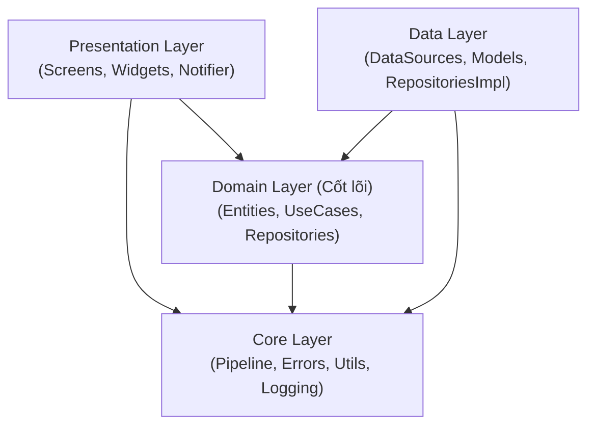
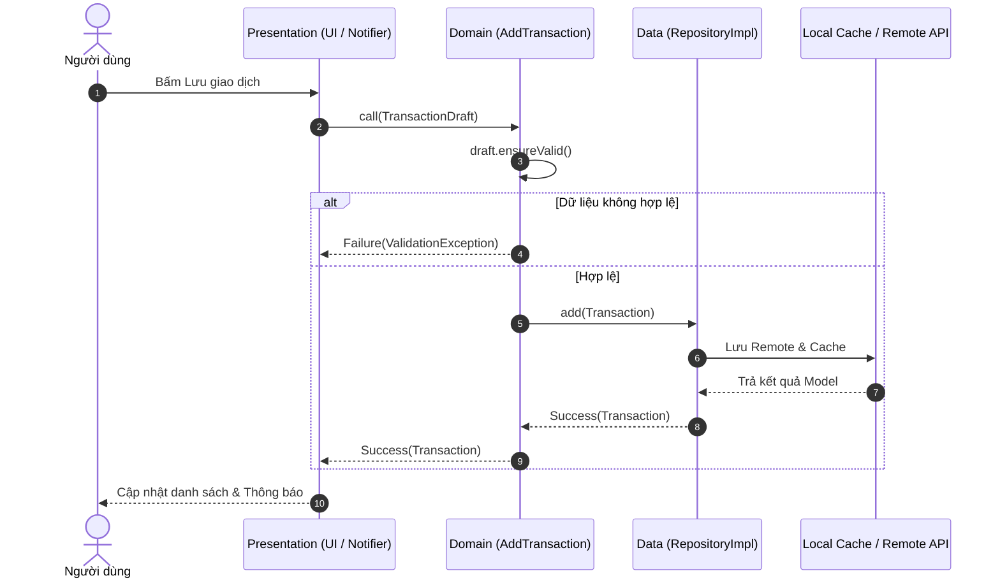

# KỊCH BẢN VÀ DÀN Ý SLIDE THUYẾT TRÌNH BÁO CÁO ĐỒ ÁN (SLIDE_OUTLINE.md)

> **Môn học:** Lập trình ứng dụng di động nâng cao (Advanced Mobile Programming)  
> **Chủ đề 01:** Sổ Chi Tiêu Cá Nhân (Expense Tracker)  
> **Thời lượng phần lý thuyết:** 10 phút (Khung báo cáo chuẩn)  
> **Phân vai trình bày:**  
> - **Sinh viên A (Nguyễn Đức Hải - `@hainguyen0412`):** OOP nâng cao (Phần 2) & Xử lý ngoại lệ tập trung (Phần 4).  
> - **Sinh viên B (Phạm Nhung - MSSV: 106230021 - `@Nhung106230021`):** Bài toán, WBS, Kiến trúc & Data Flow (Phần 1) & Repository, Factory Pattern, Domain Layer (Phần 3).  

---

## MỤC LỤC BỐ CỤC SLIDE (TỔNG CỘNG 13 SLIDE)

- **Phần 1: Bài toán, WBS, Kiến trúc tổng thể & Luồng dữ liệu (2 phút - SV B)**
  - Slide 1: Giới thiệu đề tài & Bảng phân công công việc (WBS)
  - Slide 2: Kiến trúc Clean Architecture 4 tầng & Luồng dữ liệu (Data Flow)
- **Phần 2: Lập trình hướng đối tượng (OOP) nâng cao trong Dart 3 (3 phút - SV A)**
  - Slide 3: Constructor nâng cao: Named & Factory Constructor
  - Slide 4: Tái sử dụng hành vi với Dart Mixins (Composition over Inheritance)
  - Slide 5: Kiểu dữ liệu an toàn: Generic Result Pattern & Sealed Class
- **Phần 3: Repository Pattern, Factory Pattern & Phân tầng Domain thuần khiết (2 phút - SV B)**
  - Slide 6: Vì sao tách riêng Domain Layer độc lập & Pure Constructor DI?
  - Slide 7: Repository Pattern kết hợp Dependency Inversion & Graceful Offline Fallback
- **Phần 4: Kiến trúc xử lý ngoại lệ tập trung & An toàn hệ thống (3 phút - SV A)**
  - Slide 8: Cây ngoại lệ phân cấp (Sealed AppException) & Factory Pattern
  - Slide 9: Centralized Error Pipeline 5 bước & Structured Logging
  - Slide 10: 3-Tier Global Safety Net (Lưới phòng thủ toàn cục)
  - Slide 11: Error Boundary & Phòng thủ UI với `try-catch-finally` thực tế
- **Phần Kết: Chuyển giao sang Demo & Tổng kết dự án (Linh hoạt - Cả 2 SV)**
  - Slide 12: Chuyển tiếp sang Demo: Error Simulator & Log Viewer
  - Slide 13: Tổng kết dự án, Chất lượng kiểm thử 100% & Q&A

---

## CHI TIẾT NỘI DUNG TỪNG SLIDE

---

### SLIDE 1: Giới thiệu đề tài & Bảng phân công công việc (WBS)
- **Thời lượng:** 1 phút (thuộc Phần 1)
- **Người trình bày:** Sinh viên B (Phạm Nhung)

#### Nội dung chính:
- **Đề tài:** Xây dựng ứng dụng **Sổ Chi Tiêu Cá Nhân (Expense Tracker)** kết hợp **Clean Architecture** và **Centralized Error Handling Pipeline**.
- **Mục tiêu:** Quản lý thu chi theo thời gian thực; tự phục hồi khi gặp lỗi I/O mạng; hỗ trợ xem và điều khiển lỗi bằng Error Simulator và Log Viewer.
- **Cam kết môi trường:** 100% chạy độc lập không phụ thuộc Firebase, không cần tệp cấu hình `.env` hay `google-services.json`.
- **Phân bổ WBS cân bằng 50% – 50%:** Chia rõ theo đúng 5 nhóm vai trò kỹ thuật bắt buộc của đề tài.

#### Bảng phân công WBS chi tiết:
| Nhóm vai trò | Nhiệm vụ chính & Danh mục Ticket | Phụ trách | Tỷ lệ |
| :--- | :--- | :---: | :---: |
| **UI Design** | Thiết kế Material 3 Theme, List Screen (`T-302`), Form Screen (`T-303`), ErrorView, EmptyView | **SV B** | 50% |
| **Business Logic** | Git Setup, CI (`T-003`, `T-004`), Entities (`T-101`, `T-102`), Validation Rules (`T-103`), 6 Use Cases (`T-105`) | **SV A** | 50% |
| **State Management** | State Notifier (`T-301`), Pipeline (`T-204`), 3-Tier Safety Net (`T-205`), ErrorBoundary (`T-304`), MultiProvider | **SV A** | 50% |
| **Database / API** | Models & JSON (`T-106`), FakeRemote & LocalCache (`T-107`), RepositoryImpl (`T-108`), FileLogger (`T-202`) | **SV B** | 50% |
| **Báo cáo / Slide / QA** | Error Simulator (`T-305`), Log Viewer (`T-306`), 223 Tests (`T-401`), Clean Code (`T-402`), Docs & Slide (`T-403`-`T-406`) | **SV A & B** | 50% - 50% |

#### Ghi chú người nói (Speaker Notes):
> "Kính thưa thầy cô và các bạn, nhóm chúng em chọn Chủ đề 01: Sổ Chi Tiêu Cá Nhân. Thay vì chỉ xây dựng một ứng dụng CRUD đơn giản, chúng em đặt trọng tâm vào việc thiết kế một kiến trúc chuẩn mực chịu lỗi cao, sẵn sàng phục hồi khi mất mạng. Toàn bộ khối lượng công việc được phân bổ cân bằng tuyệt đối 50% – 50% qua 5 nhóm vai trò bắt buộc, thể hiện rõ qua lịch sử commit và quản lý ticket trên Git."

---

### SLIDE 2: Kiến trúc Clean Architecture 4 tầng & Luồng dữ liệu (Data Flow)
- **Thời lượng:** 1 phút (thuộc Phần 1)
- **Người trình bày:** Sinh viên B (Phạm Nhung)

#### Nội dung chính:
- **Nguyên lý Dependency Rule:** Phụ thuộc một chiều từ ngoài vào trong; tầng Domain nằm ở trung tâm và tuyệt đối không biết gì về UI hay Database.
- **Tầng Core độc lập:** Cung cấp hạ tầng chung (Result pattern, Cây ngoại lệ AppException, Pipeline xử lý lỗi) cho cả 3 tầng còn lại.
- **Luồng dữ liệu (Data Flow):** UI gọi Use Case -> Use Case kiểm tra Validation -> Repository điều phối Remote và Local Cache -> Trả về `Result<T>` an toàn cho UI render.

#### Hình minh họa 1: Clean Architecture 4 tầng & Chiều phụ thuộc


#### Hình minh họa 2: Sơ đồ luồng dữ liệu (Data Flow Sequence)


#### Ghi chú người nói (Speaker Notes):
> "Kiến trúc ứng dụng của chúng em tuân thủ nghiêm ngặt Clean Architecture 4 tầng. Điểm cốt lõi là luồng dữ liệu và chiều phụ thuộc luôn hướng tâm về tầng Domain. Khi người dùng bấm lưu một khoản chi tiêu, dữ liệu phải đi qua Use Case để thẩm định nghiệp vụ trước khi được chuyển xuống Repository. Nhờ vậy, tầng giao diện hoàn toàn không có quyền can thiệp hay phụ thuộc trực tiếp vào cấu trúc cơ sở dữ liệu bên dưới."

---

### SLIDE 3: Constructor nâng cao: Named & Factory Constructor
- **Thời lượng:** 1 phút (thuộc Phần 2)
- **Người trình bày:** Sinh viên A (Nguyễn Đức Hải)

#### Nội dung chính:
- **R1 (Named Constructor):** Tăng tính biểu đạt ngữ nghĩa (expressiveness), tạo các trạng thái mặc định an toàn (`Money.zero()`, `TransactionSummary.empty()`, `ErrorView.compact()`).
- **R2 (Factory Constructor):** Đóng gói logic khởi tạo phức tạp; có khả năng trả về instance tái sử dụng hoặc ném ngoại lệ phân loại trước khi cấp phát bộ nhớ.
- **Phòng thủ JSON:** `TransactionModel.fromJson` chặn đứng toàn bộ lỗi `TypeError` và `Null` thô, chuyển đổi thành `ParseException`.

#### Đoạn mã nguồn trích dẫn từ Repo:
*Named Constructor: `lib/domain/entities/money.dart` (Dòng 19 – 23)*
```dart
  /// Khởi tạo đối tượng [Money] với giá trị bằng 0 đồng.
  ///
  /// Áp dụng **R1 (Named constructor)**.
  const Money.zero() : amount = 0;
```

*Factory Constructor: `lib/data/models/transaction_model.dart` (Dòng 68 – 76)*
```dart
  factory TransactionModel.fromJson(Object? json) {
    if (json == null || json is! Map) {
      throw ParseException(
        message:
            'Invalid JSON: Expected a Map but got ${json?.runtimeType ?? 'null'}',
        originalError: json,
        stackTrace: StackTrace.current,
      );
    }
```

#### Ghi chú người nói (Speaker Notes):
> "Trong Dart 3, chúng em tận dụng Named Constructor để code tự sinh tài liệu, ví dụ `Money.zero()` giúp khởi tạo giá trị tiền rỗng một cách tường minh mà không cần truyền số 0 ma thuật. Đối với Factory Constructor, thay vì khởi tạo đối tượng mù quáng, chúng em sử dụng nó như một chốt chặn bảo vệ: nếu dữ liệu JSON từ API bị null hoặc sai kiểu Map, factory sẽ chặn ngay lập tức và ném ra `ParseException` có cấu trúc rõ ràng."

---

### SLIDE 4: Tái sử dụng hành vi với Dart Mixins
- **Thời lượng:** 1 phút (thuộc Phần 2)
- **Người trình bày:** Sinh viên A (Nguyễn Đức Hải)

#### Nội dung chính:
- **R3 (Mixins):** Triển khai nguyên lý Composition over Inheritance; tái sử dụng các hành vi dùng chung mà không làm vỡ đơn kế thừa của Dart.
- **`LoggableMixin`:** Tự động gắn tag định danh tên class cho các bản ghi log thông qua reflection-free `runtimeType`.
- **`ValidatableMixin`:** Chuẩn hóa giao diện kiểm tra tính hợp lệ và trích xuất lỗi đầu tiên cho cả Entity và Draft.
- **`TimestampMixin`:** Tự động hóa quản lý hai mốc thời gian `createdAt` và `updatedAt`.

#### Đoạn mã nguồn trích dẫn từ Repo:
*`lib/core/utils/validatable_mixin.dart` (Dòng 18 – 35)*
```dart
mixin ValidatableMixin {
  /// Cho biết toàn bộ dữ liệu của đối tượng có hợp lệ hay không.
  bool get isValid => validate().isEmpty;

  /// Trả về lỗi vi phạm hợp lệ đầu tiên nếu có, ngược lại trả về `null`.
  ValidationException? get firstError => validate().firstOrNull;

  /// Đảm bảo đối tượng hợp lệ dưới dạng [Result<void>].
  Result<void> ensureValid() {
    final error = firstError;
    if (error == null) return const Success(null);
    return Failure(error);
  }
}
```

#### Ghi chú người nói (Speaker Notes):
> "Thay vì lặp lại code kiểm tra hợp lệ trên từng màn hình hoặc tạo các class Helper vô hướng, chúng em tạo `ValidatableMixin`. Bất kỳ Entity hay Model nào khi mixin đều lập tức sở hữu getter `isValid` và phương thức `ensureValid()`. Điều này giúp giảm thiểu tối đa sự trùng lặp mã nguồn mà vẫn giữ nguyên tính độc lập của các class nghiệp vụ."

---

### SLIDE 5: Kiểu dữ liệu an toàn: Generic Result Pattern & Sealed Class
- **Thời lượng:** 1 phút (thuộc Phần 2)
- **Người trình bày:** Sinh viên A (Nguyễn Đức Hải)

#### Nội dung chính:
- **R4 (Generics):** Thiết kế `sealed class Result<T>` đại diện cho kết quả thao tác bất đồng bộ: hoặc thành công `Success<T>`, hoặc thất bại `Failure<T>`.
- **Functional Error Handling:** Loại bỏ hoàn toàn việc throw unhandled exception qua các tầng; buộc caller phải xử lý cả 2 nhánh.
- **Hỗ trợ hàm bậc cao:** Cung cấp các phương thức `fold()`, `map()`, `getOrElse()` giúp code ngắn gọn và an toàn type-safe.

#### Đoạn mã nguồn trích dẫn từ Repo:
*`lib/core/utils/result.dart` (Dòng 17 – 34)*
```dart
sealed class Result<T> {
  const Result();

  /// Cho biết thao tác đã hoàn thành thành công hay chưa.
  bool get isSuccess;

  /// Cho biết thao tác có gặp thất bại hay không.
  bool get isFailure => !isSuccess;

  /// Rẽ nhánh xử lý kết quả dựa trên trạng thái thành công hoặc thất bại.
  R fold<R>(
    R Function(T data) onSuccess,
    R Function(AppException error) onFailure,
  );
}
```

#### Ghi chú người nói (Speaker Notes):
> "Trong lập trình di động truyền thống, việc dùng try-catch ở khắp nơi rất dễ gây sót lỗi và crash app. Chúng em áp dụng Result Pattern kết hợp Generic `<T>` và Sealed Class của Dart 3. Bằng cách này, trình biên dịch sẽ ép buộc tầng UI phải xử lý cả trường hợp Success và Failure thông qua hàm `fold()`, ngăn chặn triệt để tình trạng bỏ quên lỗi."

---

### SLIDE 6: Vì sao tách riêng Domain Layer độc lập & Pure Constructor DI?
- **Thời lượng:** 1 phút (thuộc Phần 3)
- **Người trình bày:** Sinh viên B (Phạm Nhung)

#### Nội dung chính:
- **R5 (Domain thuần khiết):** Tầng Domain 100% là Pure Dart, không import Flutter, không import package bên ngoài, không phụ thuộc tầng Data.
- **Pure Constructor Injection:** Toàn bộ dependencies được đưa vào qua Constructor, loại bỏ hoàn toàn service locator ẩn (`GetIt`).
- **Khả năng kiểm thử (Testability):** Cho phép inject đồng hồ giả lập (`clock`) và bộ sinh mã giả lập (`idGenerator`) để viết Unit Test độc lập hoàn toàn với thời gian thực của máy tính.

#### Đoạn mã nguồn trích dẫn từ Repo:
*`lib/domain/usecases/add_transaction.dart` (Dòng 26 – 31)*
```dart
  /// Khởi tạo [AddTransaction] bằng Pure Constructor Injection.
  AddTransaction(
    this._repository, {
    String Function()? idGenerator,
    DateTime Function()? clock,
  })  : _idGenerator = idGenerator ?? _defaultIdGenerator,
        _clock = clock ?? _defaultClock;
```

#### Ghi chú người nói (Speaker Notes):
> "Một câu hỏi rất hay là: Tại sao phải tách riêng tầng Domain khi dự án nhỏ? Câu trả lời là để bảo vệ logic nghiệp vụ không bị ràng buộc bởi framework UI. Khi tầng Domain là Pure Dart và sử dụng Pure Constructor Injection, chúng em có thể kiểm thử toàn bộ 6 usecases chỉ trong 0.2 giây mà không cần khởi động môi trường Flutter, và có thể inject đồng hồ giả lập để test chính xác các mốc thời gian biên."

---

### SLIDE 7: Repository Pattern kết hợp Dependency Inversion & Fallback Cache
- **Thời lượng:** 1 phút (thuộc Phần 3)
- **Người trình bày:** Sinh viên B (Phạm Nhung)

#### Nội dung chính:
- **R6 (Repository Pattern & DIP):** Domain khai báo `TransactionRepository` interface; Data triển khai `TransactionRepositoryImpl`.
- **R8 (Graceful Offline Degradation):** Khi truy vấn remote gặp `NetworkException` hoặc `TimeoutException`, Repository tự động kích hoạt chế độ fallback đọc từ `LocalCacheDataSource`.
- **Bảo toàn trải nghiệm:** Người dùng vẫn xem được dữ liệu cũ kèm thông báo cảnh báo thay vì bị màn hình trắng xóa.

#### Đoạn mã nguồn trích dẫn từ Repo:
*`lib/data/repositories/transaction_repository_impl.dart` (Dòng 57 – 65)*
```dart
  bool _shouldFallbackToCache(AppException error) {
    return switch (error) {
      NetworkException() => true,
      RequestTimeoutException() => true,
      ServerException(:final statusCode) => statusCode >= 500,
      ParseException() => true,
      _ => false,
    };
  }
```

#### Ghi chú người nói (Speaker Notes):
> "Nhờ Repository Pattern, tầng Data có toàn quyền quyết định chiến lược lưu trữ dữ liệu. Phương thức `_shouldFallbackToCache` sử dụng pattern matching để xác định: nếu là lỗi mạng hoặc máy chủ 500 thì tự động chuyển sang đọc bộ nhớ đệm cục bộ `SharedPreferences`. Điều này chứng minh ứng dụng của chúng em có khả năng chịu lỗi (fault-tolerant) và đảm bảo tính liên tục cho người dùng."

---

### SLIDE 8: Cây ngoại lệ phân cấp (Sealed AppException) & Factory Pattern
- **Thời lượng:** 0.75 phút (thuộc Phần 4)
- **Người trình bày:** Sinh viên A (Nguyễn Đức Hải)

#### Nội dung chính:
- **R9 (Cây ngoại lệ phân cấp):** `sealed class AppException` định nghĩa 8 loại ngoại lệ cụ thể bao quát toàn bộ lỗi hệ thống (Network, Timeout, Server, Parse, Cache, Validation, NotFound, Unknown).
- **R7 (Factory Pattern):** `ExceptionFactory.from()` tập trung hóa logic phân loại mọi lỗi thô (`SocketException`, `HttpException`, `FormatException`) thành ngoại lệ chuẩn.
- **Exhaustive Matching:** Nhờ từ khóa `sealed`, trình biên dịch Dart sẽ bắt lỗi biên dịch ngay lập tức nếu một biểu thức `switch` xử lý thiếu bất kỳ loại ngoại lệ nào.

#### Đoạn mã nguồn trích dẫn từ Repo:
*`lib/core/errors/app_exception.dart` (Dòng 30 – 41)*
```dart
sealed class AppException implements Exception {
  final String message;
  final String code;
  final Severity severity;
  final Object? originalError;
  final StackTrace? stackTrace;

  const AppException({
    required this.message,
    required this.code,
    required this.severity,
    this.originalError,
    this.stackTrace,
  });
```

#### Ghi chú người nói (Speaker Notes):
> "Thay vì sử dụng các chuỗi String tự do để mô tả lỗi, chúng em chuẩn hóa toàn bộ lỗi vào cây ngoại lệ `AppException` dạng `sealed class`. Điểm mạnh nhất của sealed class trong Dart 3 là tính vét cạn: nếu sau này hệ thống bổ sung thêm một lớp lỗi mới, trình biên dịch sẽ chỉ rõ chính xác những nơi nào chưa xử lý case đó, loại bỏ hoàn toàn lỗi runtime tiềm ẩn."

---

### SLIDE 9: Centralized Error Pipeline 5 bước & Structured Logging
- **Thời lượng:** 0.75 phút (thuộc Phần 4)
- **Người trình bày:** Sinh viên A (Nguyễn Đức Hải)

#### Nội dung chính:
- **R11 (Pipeline 5 bước):** Mọi lỗi đều đi qua `ErrorHandler.handle()`:
  1. *Normalize:* Chuẩn hóa lỗi thô thành `AppException`.
  2. *Classify:* Xác định `Severity` (info, warning, error, critical).
  3. *Log:* Ghi tuần tự ra `ConsoleLogger` và `FileLogger`.
  4. *Decide Retry:* Đánh giá khả năng tự phục hồi (`canRetry`).
  5. *Translate:* Ánh xạ sang thông điệp tiếng Việt thân thiện bằng `ErrorMessageMapper`.
- **Structured Logging bền vững:** `FileLogger` sử dụng khóa tuần tự Mutex, lưu tối đa 500 dòng JSON Lines vào tệp `app_errors.log`.

#### Đoạn mã nguồn trích dẫn từ Repo:
*`lib/core/error_handling/error_handler.dart` (Dòng 43 – 57)*
```dart
      // Bước 1: Chuẩn hóa mọi lỗi thô thành cây ngoại lệ AppException
      final AppException appEx = _normalize(error, st);
      // Bước 2: Phân loại mức độ nghiêm trọng (nâng cấp nếu là lỗi toàn cục lọt lưới)
      final Severity severity = _classify(appEx, source);
      // Bước 3: Ghi nhật ký lỗi có cấu trúc tới toàn bộ danh sách logger
      await _log(appEx, severity, st, source);
      // Bước 4: Đánh giá khả năng cho phép người dùng bấm nút Thử lại (canRetry)
      final bool canRetry = _decideRetry(appEx);
      // Bước 5: Chuyển dịch ngoại lệ kỹ thuật sang thông điệp tiếng Việt thân thiện
      final String message = _toUserMessage(appEx);
```

#### Ghi chú người nói (Speaker Notes):
> "Điểm sáng tạo của đồ án là Centralized Error Pipeline. Thay vì mỗi màn hình tự viết câu thông báo lỗi tùy tiện, tất cả ngoại lệ đều đi qua đúng 5 bước tuần tự trong `ErrorHandler`. Tại đây, lỗi được ghi nhật ký bền vững vào file `app_errors.log` và được dịch sang tiếng Việt dễ hiểu kèm cờ `canRetry` để UI hiển thị nút Thử lại phù hợp."

---

### SLIDE 10: 3-Tier Global Safety Net (Lưới phòng thủ toàn cục)
- **Thời lượng:** 0.75 phút (thuộc Phần 4)
- **Người trình bày:** Sinh viên A (Nguyễn Đức Hải)

#### Nội dung chính:
- **R10 (3-Tier Safety Net):** Hệ thống phòng thủ 3 tầng bảo đảm ứng dụng không bao giờ bị crash trắng màn hình:
  - *Tầng 1:* `FlutterError.onError` – Bắt các ngoại lệ phát sinh trong quá trình build, layout, render của framework.
  - *Tầng 2:* `PlatformDispatcher.instance.onError` – Bắt các lỗi bất đồng bộ (async errors) lọt ra ngoài framework.
  - *Tầng 3:* `runZonedGuarded` – Bao bọc toàn bộ hàm `main()`, bảo vệ luồng thực thi gốc.
- **Tự động leo thang:** Lỗi lọt vào Safety Net được tự động gán nguồn `source: 'global'` và nâng mức độ nghiêm trọng lên `CRITICAL`.

#### Đoạn mã nguồn trích dẫn từ Repo:
*`lib/core/error_handling/global_error_hooks.dart` (Dòng 41 – 52)*
```dart
    // Lớp 1: Bắt lỗi trong quá trình build, layout, render của Flutter Framework
    FlutterError.onError = (FlutterErrorDetails details) {
      if (kDebugMode) {
        FlutterError.presentError(details);
      }
      unawaited(
        handler.handle(
          details.exception,
          details.stack ?? StackTrace.current,
          source: 'global',
        ),
      );
    };
```

#### Ghi chú người nói (Speaker Notes):
> "Dù lập trình viên có cẩn thận đến đâu, vẫn luôn có những lỗi async xảy ra ngoài widget tree mà try-catch thông thường không thể bắt được. Chúng em đã thiết lập lưới an toàn 3 tầng ngay tại điểm khởi chạy ứng dụng. Mọi lỗi lọt lưới đều được hứng trọn, ghi log kèm StackTrace và hiển thị cảnh báo cho người dùng mà không làm ứng dụng bị văng ra màn hình chính của điện thoại."

---

### SLIDE 11: Error Boundary & Phòng thủ UI với `try-catch-finally` thực tế
- **Thời lượng:** 0.75 phút (thuộc Phần 4)
- **Người trình bày:** Sinh viên A (Nguyễn Đức Hải)

#### Nội dung chính:
- **R10 (Error Boundary):** Widget `ErrorBoundary` lắng nghe kênh `errorSource` từ Notifier; khi có lỗi nghiêm trọng sẽ thay thế child bằng `ErrorView` (có nút Thử lại), bảo vệ các phần UI khác không bị ảnh hưởng.
- **`ErrorWidget.builder`:** Bắt lỗi render cục bộ, hiển thị `ErrorView.compact` thay vì màn hình sọc đỏ xám mặc định.
- **R8 (`try-catch-finally` có mục đích):** Khối `finally` trong `_run()` bảo đảm 100% reset cờ `isSubmitting = false` kể cả khi usecase xảy ra lỗi chưa lường trước, ngăn chặn tình trạng nút bấm bị treo vĩnh viễn.

#### Đoạn mã nguồn trích dẫn từ Repo:
*`lib/presentation/widgets/error_boundary.dart` (Dòng 54 – 65)*
```dart
    return ValueListenableBuilder<UserFacingError?>(
      valueListenable: errorSource,
      builder: (context, error, childWidget) {
        if (error != null) {
          return ErrorView(
            error: error,
            onRetry: onRetry,
            onDismiss: onDismiss,
          );
        }
        return childWidget ?? child;
      },
      child: child,
    );
```

#### Ghi chú người nói (Speaker Notes):
> "Flutter không có cơ chế try-catch bọc widget con như React, vì vậy chúng em đã cài đặt Error Boundary theo 2 lớp: lớp hiển thị thay thế qua `ErrorBoundary` lắng nghe state lỗi nghiêm trọng, và lớp render qua `ErrorWidget.builder`. Đồng thời, tại Notifier, khối `finally` đóng vai trò tối quan trọng: nó luôn đảm bảo tắt cờ `isSubmitting` để người dùng không bao giờ bị khóa chết nút bấm khi gặp sự cố."

---

### SLIDE 12: Chuyển tiếp sang Demo: Error Simulator & Log Viewer
- **Thời lượng:** Chuyển giao phần trình diễn
- **Người trình bày:** Sinh viên B & Sinh viên A cùng phối hợp

#### Nội dung chính:
- **Công cụ kiểm chứng:** Tích hợp trực tiếp màn hình **Error Simulator** và **Log Viewer** ngay trên AppBar.
- **6 Kịch bản demo đã chuẩn bị sẵn:**
  1. *Kịch bản 1:* Giả lập mất kết nối mạng (`SocketException`) -> Fallback Local Cache + SnackBar có nút Thử lại.
  2. *Kịch bản 2:* Giả lập quá hạn kết nối (`TimeoutException`) -> Thông báo quá hạn.
  3. *Kịch bản 3:* Giả lập lỗi máy chủ nội bộ (`Server 500`) -> Nhận diện `Severity.error`.
  4. *Kịch bản 4:* Giả lập dữ liệu JSON hỏng (`ParseException`) -> Bắt lỗi ép kiểu.
  5. *Kịch bản 5:* Giả lập lỗi render trong `build()` -> Kích hoạt `ErrorView.compact`, app không crash.
  6. *Kịch bản 6:* Giả lập lỗi async ngoài widget tree -> 3-Tier Hooks bắt và ghi log `CRITICAL` trong Log Viewer.

#### Hình minh họa: Giao diện màn hình Error Simulator & Log Viewer
```text
+-----------------------------------+   +-----------------------------------+
|  Bảng Giả Lập Lỗi (Simulator) [📜]|   |  Nhật Ký Lỗi Hệ Thống (Log Viewer)|
+-----------------------------------+   +-----------------------------------+
| 1. Chế độ mạng:                   |   | Lọc: [Tất cả] [Warning] [Error]   |
| ( ) None  (*) Socket  ( ) Timeout |   +-----------------------------------+
| ( ) 500   ( ) Parse   ( ) Random  |   | [CRITICAL] 20:15:30 • global      |
|                                   |   | Async unhandled error occurred    |
| [🔄 Tải lại danh sách (load)]     |   | > StackTrace: main.dart:42        |
|                                   |   +-----------------------------------+
| [💥 Kích hoạt lỗi render build]   |   | [WARNING] 20:14:10 • Transaction  |
| [⚡ Kích hoạt lỗi unhandled async] |   | Network socket failure            |
| [⛔ Gửi giao dịch số tiền âm]      |   +-----------------------------------+
+-----------------------------------+   | [🗑️ Xóa toàn bộ nhật ký lỗi]     |
                                        +-----------------------------------+
```

#### Ghi chú người nói (Speaker Notes):
> "Để chứng minh toàn bộ kiến trúc lý thuyết vừa trình bày hoạt động thật 100%, chúng em đã xây dựng một màn hình giả lập lỗi Error Simulator và màn hình xem nhật ký lỗi Log Viewer. Sau đây, bạn Nhung và em xin phép chuyển sang phần thực nghiệm các kịch bản lỗi trực tiếp trên ứng dụng."

---

### SLIDE 13: Tổng kết dự án, Chất lượng kiểm thử 100% & Q&A
- **Thời lượng:** Kết thúc & Trả lời câu hỏi phản biện
- **Người trình bày:** Sinh viên A & Sinh viên B

#### Nội dung chính:
- **Đạt chuẩn kỹ thuật xuất sắc:** Đáp ứng đầy đủ 11/11 yêu cầu kỹ thuật từ R1 đến R11.
- **Bộ kiểm thử toàn diện:** **223 / 223 tests PASS (100%)**, vượt xa chuẩn đề bài:
  - `lib/domain/`: **88.64%** (Mục tiêu $\ge 80\%$)
  - `lib/core/errors/`: **98.48%** (Mục tiêu $\ge 90\%$)
  - `lib/core/error_handling/`: **97.31%** (Mục tiêu $\ge 80\%$)
  - `lib/data/repositories/`: **87.88%** (Mục tiêu $\ge 80\%$)
  - `lib/presentation/state/`: **93.08%** (Mục tiêu $\ge 80\%$)
- **Clean Code 100%:** 0 warning linter, không có file UI nào vượt quá 300 dòng, 100% các hàm `build()` dưới 50 dòng.
- **Lời cảm ơn:** Trân trọng cảm ơn quý Thầy Cô đã theo dõi! Nhóm sẵn sàng lắng nghe câu hỏi phản biện.

#### Ghi chú người nói (Speaker Notes):
> "Dự án Sổ Chi Tiêu Cá Nhân không chỉ là một ứng dụng hoàn chỉnh về mặt nghiệp vụ mà còn là một minh chứng về chuẩn mực kỹ thuật trong phát triển ứng dụng di động: từ Clean Architecture, Centralized Error Pipeline, cho đến bộ kiểm thử tự động 223 tests đạt tỷ lệ bao phủ trên 88%. Nhóm chúng em xin chân thành cảm ơn Thầy Cô và rất mong nhận được những góp ý quý báu!"

---

*Tài liệu dàn ý được xuất bản và đối chiếu chính xác theo mã nguồn dự án tại thời điểm Sprint 4.*
