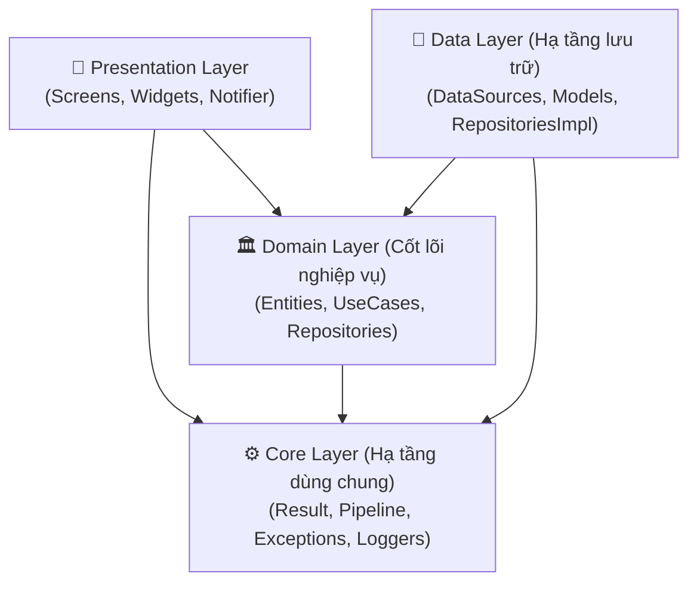
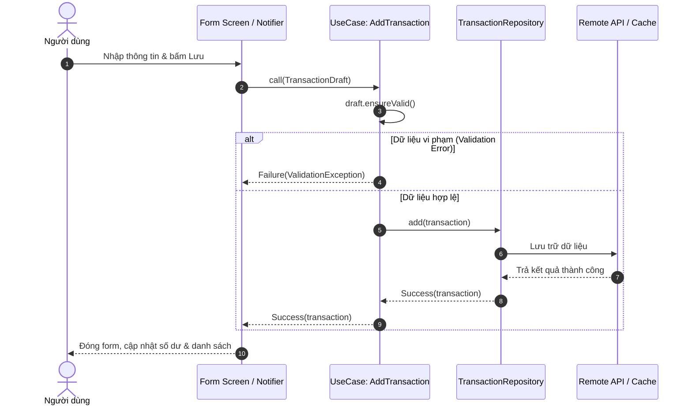
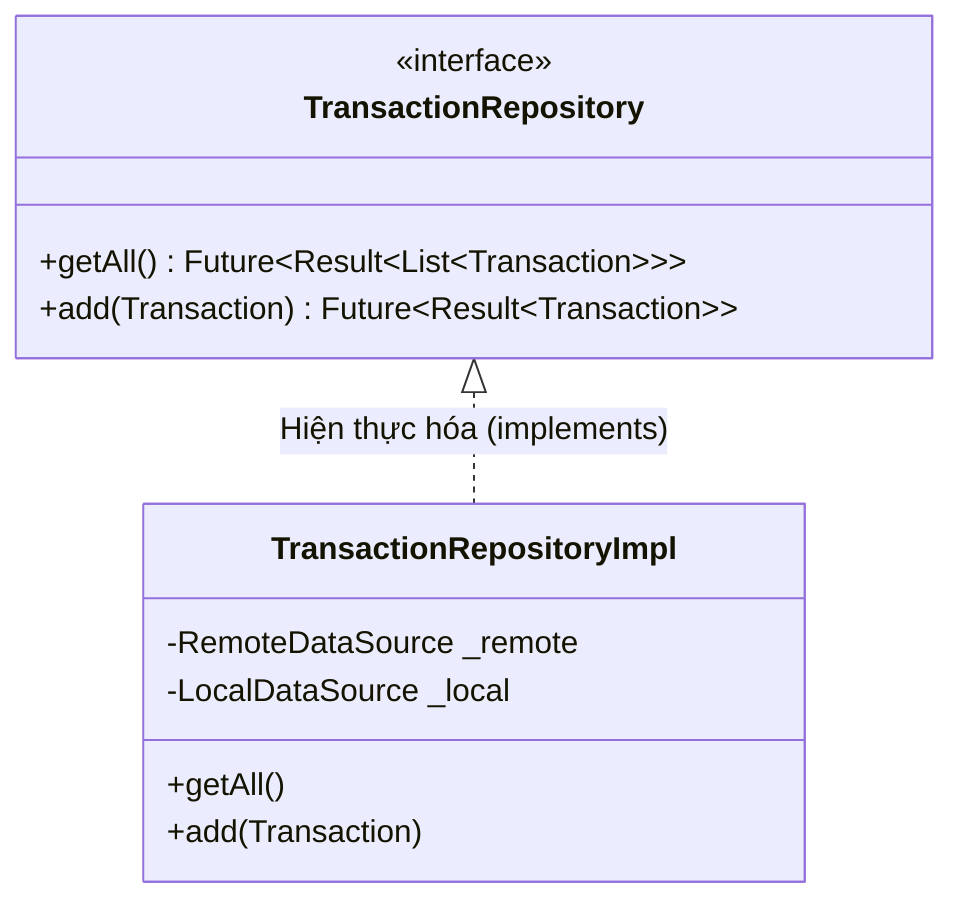
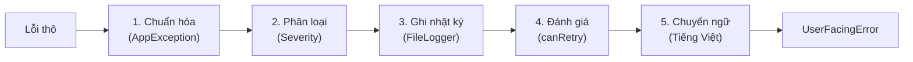

# KỊCH BẢN VÀ DÀN Ý SLIDE BÁO CÁO ĐỒ ÁN (SLIDE_OUTLINE.md)

> **Môn học:** Lập trình ứng dụng di động nâng cao (Advanced Mobile Programming)  
> **Chủ đề 01:** Sổ Chi Tiêu Cá Nhân (Expense Tracker)  
> **Phong cách slide:** Hiện đại, trực quan, ít chữ (Minimal text), giàu sơ đồ (Mermaid diagrams) & mã nguồn trích dẫn ngắn.  
> **Tổng số slide:** 20 slide | **Thời lượng thuyết trình:** ~10 phút lý thuyết + Demo & Q&A.  
> **Phân vai:**  
> - **Sinh viên B (Phạm Nhung - MSSV: 106230021):** Tổng quan, WBS, Kiến trúc, Data Flow, Domain Layer & Repository Pattern.  
> - **Sinh viên A (Nguyễn Đức Hải):** OOP nâng cao, Cây ngoại lệ, Pipeline xử lý lỗi, 3-Tier Safety Net, Error Boundary & Tổng kết.  

---

## 📑 MỤC LỤC BỐ CỤC 20 SLIDE

- **PHẦN 1: TỔNG QUAN, WBS & KIẾN TRÚC TỔNG THỂ (SV B)**
  - Slide 1: Trang bìa giới thiệu đề tài & thành viên
  - Slide 2: Bài toán thực tế & Mục tiêu sản phẩm
  - Slide 3: Bảng phân công công việc WBS (50% – 50%)
  - Slide 4: Kiến trúc Clean Architecture 4 tầng (Sơ đồ Dependency Rule)
  - Slide 5: Luồng dữ liệu xuyên tầng (Data Flow Sequence Diagram)
- **PHẦN 2: OOP NÂNG CAO TRONG DART 3 (SV A)**
  - Slide 6: Named Constructor: Rõ ràng ngữ nghĩa & Immutability
  - Slide 7: Factory Constructor: Chốt chặn phòng thủ dữ liệu JSON
  - Slide 8: Dart Mixins: Tái sử dụng logic (Composition over Inheritance)
  - Slide 9: Type-Safety: Generic Result Pattern (`Result<T>`)
- **PHẦN 3: PHÂN TẦNG DOMAIN & DESIGN PATTERNS (SV B)**
  - Slide 10: Tách riêng Domain thuần khiết (Pure Dart)
  - Slide 11: Pure Constructor Dependency Injection & Testability
  - Slide 12: Repository Pattern & Dependency Inversion Principle (DIP)
  - Slide 13: Chiến lược Fallback Cache khi mất mạng (Graceful Degradation)
- **PHẦN 4: KIẾN TRÚC XỬ LÝ NGOẠI LỆ TẬP TRUNG (SV A)**
  - Slide 14: Cây ngoại lệ phân cấp: Sealed Class `AppException` (8 lớp con)
  - Slide 15: Factory Pattern: Phân loại lỗi tập trung với `ExceptionFactory`
  - Slide 16: Centralized Error Pipeline 5 bước tuần tự
  - Slide 17: 3-Tier Global Safety Net (Lưới hứng lỗi toàn cục)
  - Slide 18: Error Boundary & Phòng thủ UI với `try-catch-finally`
- **PHẦN 5: CHUYỂN GIAO DEMO & TỔNG KẾT (SV B & SV A)**
  - Slide 19: Chuyển tiếp sang Demo: Error Simulator & Log Viewer
  - Slide 20: Tổng kết dự án: Chất lượng kiểm thử 100% & Q&A

---

## CHI TIẾT NỘI DUNG TỪNG SLIDE

---

### SLIDE 1: Trang bìa giới thiệu đề tài & Thành viên
- **Người trình bày:** Sinh viên B (Phạm Nhung)
- **Bố cục:** Slide tiêu đề lớn, logo trường, thông tin 2 thành viên.

#### Nội dung chính:
- **ĐỒ ÁN:** LẬP TRÌNH ỨNG DỤNG DI ĐỘNG NÂNG CAO
- **CHỦ ĐỀ 01:** SỔ CHI TIÊU CÁ NHÂN (EXPENSE TRACKER)
- **Kiến trúc:** Clean Architecture & Centralized Error Handling Pipeline
- **Thành viên nhóm:**
  - **Nguyễn Đức Hải** (GitHub: `@hainguyen0412`) – Sinh viên A
  - **Phạm Nhung** (MSSV: `106230021` - GitHub: `@Nhung106230021`) – Sinh viên B
- **Nền tảng hỗ trợ:** Android, iOS, Windows, Web

#### Ghi chú người nói (Speaker Notes):
> "Kính chào Thầy Cô và các bạn. Hôm nay, nhóm chúng em xin báo cáo đồ án Chủ đề 01: Sổ Chi Tiêu Cá Nhân. Đồ án tập trung vào việc áp dụng Clean Architecture chuẩn mực và xây dựng hệ thống xử lý lỗi tập trung chịu lỗi cao trên nền tảng Flutter."

---

### SLIDE 2: Bài toán thực tế & Mục tiêu sản phẩm
- **Người trình bày:** Sinh viên B (Phạm Nhung)
- **Hình thức:** 3 cột so sánh (Vấn đề -> Giải pháp -> Giá trị).

#### Nội dung chính:
- **Vấn đề thực tế:**
  - Ứng dụng di động dễ sập (crash) do mạng chập chờn, API timeout hoặc dữ liệu JSON bị thay đổi.
  - Xử lý lỗi chắp vá bằng try-catch rải rác, thông báo lỗi tiếng Anh kỹ thuật gây khó hiểu cho người dùng.
- **Giải pháp của nhóm:**
  - **Clean Architecture:** Tách biệt tuyệt đối giữa nghiệp vụ và giao diện.
  - **Centralized Pipeline:** Tập trung hóa toàn bộ logic xử lý, ghi log và dịch lỗi sang tiếng Việt.
  - **Fault-Tolerance:** Tự động fallback về bộ nhớ đệm offline khi mất kết nối mạng.

#### Ghi chú người nói (Speaker Notes):
> "Trong thực tế, người dùng rất khó chịu khi ứng dụng bị văng đột ngột chỉ vì mạng yếu hay server trả về lỗi 500. Mục tiêu của nhóm em là biến một ứng dụng quản lý thu chi thành một hệ thống có khả năng tự phục hồi, bảo toàn dữ liệu và luôn mang lại trải nghiệm mượt mà."

---

### SLIDE 3: Bảng phân công công việc WBS (50% – 50%)
- **Người trình bày:** Sinh viên B (Phạm Nhung)
- **Hình thức:** Bảng phân chia trực quan theo 5 nhóm vai trò bắt buộc.

#### Nội dung chính:
| Nhóm vai trò bắt buộc | Nhiệm vụ kỹ thuật | Người phụ trách | Tỷ lệ |
| :--- | :--- | :---: | :---: |
| **1. UI Design** | Material 3 Theme, List Screen, Form Screen, ErrorView | **Phạm Nhung** | 50% |
| **2. Business Logic** | Entities, Validation Rules, 6 Use Cases, Git Setup | **Nguyễn Đức Hải** | 50% |
| **3. State Management** | TransactionNotifier, Error Pipeline, Safety Net, MultiProvider | **Nguyễn Đức Hải** | 50% |
| **4. Database / API** | Models & JSON, FakeRemote, LocalCache, FileLogger | **Phạm Nhung** | 50% |
| **5. Báo cáo / Slide / QA** | Error Simulator, Log Viewer, 223 Tests, Refactor, Docs | **Cả 2 thành viên** | 50% - 50% |

#### Ghi chú người nói (Speaker Notes):
> "Nhóm chúng em chia đều khối lượng công việc 50% - 50% theo đúng 5 vai trò kỹ thuật của đề bài. Em phụ trách giao diện và tầng dữ liệu; bạn Hải phụ trách logic nghiệp vụ, quản lý trạng thái và kiến trúc xử lý lỗi. Hai bạn cùng phối hợp viết test và hoàn thiện tài liệu."

---

### SLIDE 4: Kiến trúc Clean Architecture 4 tầng
- **Người trình bày:** Sinh viên B (Phạm Nhung)
- **Hình thức:** Sơ đồ kiến trúc Mermaid hình phễu hướng tâm.

#### Nội dung chính:
- **Nguyên lý Dependency Rule:** Phụ thuộc hướng tâm 1 chiều.
- **Domain Layer:** Nằm ở vị trí trung tâm, không phụ thuộc bất kỳ ai.
- **Presentation & Data:** Phụ thuộc ngược vào Domain.
- **Core Layer:** Cung cấp hạ tầng dùng chung cho toàn bộ hệ thống.

#### Sơ đồ kiến trúc Mermaid:


#### Ghi chú người nói (Speaker Notes):
> "Đây là sơ đồ kiến trúc 4 tầng của dự án. Mũi tên phụ thuộc chỉ đi từ ngoài vào trong. Nhờ cấu trúc này, giao diện Flutter và cơ sở dữ liệu SharedPreferences chỉ là chi tiết bên ngoài, không thể làm ảnh hưởng tới các quy tắc nghiệp vụ tài chính cốt lõi ở tầng Domain."

---

### SLIDE 5: Luồng dữ liệu hệ thống (Data Flow)
- **Người trình bày:** Sinh viên B (Phạm Nhung)
- **Hình thức:** Sơ đồ tương tác tuần tự (Sequence Diagram).

#### Nội dung chính:
- Bấm **Lưu** trên UI -> Kích hoạt `TransactionNotifier`.
- Notifier gọi Use Case `AddTransaction` để kiểm tra **Domain Validation**.
- Use Case gọi `TransactionRepository` để lưu dữ liệu.
- Repository điều phối ghi vào **Remote API** và **Local Cache**.
- Kết quả trả về dưới dạng `Result<Transaction>` an toàn cho UI cập nhật.

#### Sơ đồ Sequence Diagram:


#### Ghi chú người nói (Speaker Notes):
> "Sơ đồ này minh họa luồng dữ liệu khi người dùng thêm giao dịch. Dữ liệu bắt buộc phải qua Use Case kiểm tra tính hợp lệ trước khi chạm tới Repository. Nếu người dùng nhập số tiền âm, lỗi bị chặn ngay tại Use Case mà không tốn tài nguyên gọi xuống cơ sở dữ liệu."

---

### SLIDE 6: Named Constructor: Ngữ nghĩa & Immutability (R1)
- **Người trình bày:** Sinh viên A (Nguyễn Đức Hải)
- **Hình thức:** Khái niệm + Trích dẫn code 4 dòng + Lợi ích.

#### Nội dung chính:
- **Tăng tính biểu đạt (Expressiveness):** Tên hàm nói lên mục đích khởi tạo.
- **Loại bỏ giá trị ma thuật:** `Money.zero()` thay cho `Money(0)`.
- **Tối ưu hóa bộ nhớ:** Kết hợp từ khóa `const` để tạo hằng số biên dịch.

#### Đoạn code minh họa:
*Trích `lib/domain/entities/money.dart` (Dòng 19 – 23):*
```dart
  /// Khởi tạo đối tượng [Money] với giá trị bằng 0 đồng.
  /// Áp dụng **R1 (Named constructor)**.
  const Money.zero() : amount = 0;
```

#### Ghi chú người nói (Speaker Notes):
> "Bắt đầu với OOP nâng cao, chúng em tận dụng Named Constructor của Dart để mã nguồn tự giải thích chính nó. Thay vì để lập trình viên truyền số 0 tùy tiện, `Money.zero()` đảm bảo khởi tạo một đối tượng bất biến với giá trị mặc định chuẩn mực."

---

### SLIDE 7: Factory Constructor: Chốt chặn dữ liệu JSON (R2)
- **Người trình bày:** Sinh viên A (Nguyễn Đức Hải)
- **Hình thức:** Khái niệm + Trích dẫn code phòng thủ + Lợi ích.

#### Nội dung chính:
- **Phòng thủ kiểu dữ liệu (Defensive Parsing):** Kiểm tra cấu trúc trước khi khởi tạo.
- **Ngăn chặn lỗi runtime:** Chặn đứng `TypeError`, `NullCheckError` từ API.
- **Chuẩn hóa lỗi:** Chuyển đổi dữ liệu hỏng thành `ParseException` có cấu trúc.

#### Đoạn code minh họa:
*Trích `lib/data/models/transaction_model.dart` (Dòng 68 – 76):*
```dart
  factory TransactionModel.fromJson(Object? json) {
    if (json == null || json is! Map) {
      throw ParseException(
        message: 'Invalid JSON: Expected a Map but got ${json?.runtimeType}',
        originalError: json,
        stackTrace: StackTrace.current,
      );
    }
```

#### Ghi chú người nói (Speaker Notes):
> "Factory Constructor trong `TransactionModel` đóng vai trò người gác cổng dữ liệu. Khi máy chủ trả về JSON sai định dạng hoặc bị null, factory sẽ chặn lại và ném ra `ParseException` kèm StackTrace rõ ràng, ngăn chặn hoàn toàn việc app bị crash âm thầm."

---

### SLIDE 8: Dart Mixins: Tái sử dụng logic (R3)
- **Người trình bày:** Sinh viên A (Nguyễn Đức Hải)
- **Hình thức:** Sơ đồ Composition + Trích dẫn code mixin.

#### Nội dung chính:
- **Composition over Inheritance:** Nhúng hành vi vào class mà không làm xáo trộn cây kế thừa.
- **Bộ 3 Mixin chuyên biệt (`lib/core/utils/`):**
  - `ValidatableMixin`: Chuẩn hóa getter `isValid` và phương thức `ensureValid()`.
  - `LoggableMixin`: Tự động trích xuất `runtimeType` làm tag ghi nhật ký.
  - `TimestampMixin`: Tự động hóa quản lý `createdAt` và `updatedAt`.

#### Đoạn code minh họa:
*Trích `lib/core/utils/validatable_mixin.dart` (Dòng 18 – 28):*
```dart
mixin ValidatableMixin {
  bool get isValid => validate().isEmpty;
  ValidationException? get firstError => validate().firstOrNull;

  Result<void> ensureValid() {
    final error = firstError;
    if (error == null) return const Success(null);
    return Failure(error);
  }
}
```

#### Ghi chú người nói (Speaker Notes):
> "Dart chỉ hỗ trợ đơn kế thừa, do đó chúng em sử dụng Mixin để tái sử dụng logic. Chỉ cần gắn `with ValidatableMixin`, bất kỳ Entity hay Draft nào cũng lập tức có khả năng tự kiểm tra hợp lệ, giúp mã nguồn cô đọng và tuân thủ nguyên lý DRY."

---

### SLIDE 9: Generic Result Pattern & Functional Handling (R4)
- **Người trình bày:** Sinh viên A (Nguyễn Đức Hải)
- **Hình thức:** Sơ đồ 2 nhánh `Success` / `Failure` + Code `fold()`.

#### Nội dung chính:
- **Type-Safety với `<T>`:** Ép buộc xác định kiểu dữ liệu trả về lúc biên dịch.
- **Loại bỏ ném ngoại lệ tùy tiện:** Thay thế `throw` bằng đối tượng dữ liệu an toàn.
- **Hỗ trợ lập trình hàm (Functional):** Xử lý cả 2 trường hợp qua phương thức `fold()`.

#### Sơ đồ cấu trúc Result<T>:
```text
                  +-------------------+
                  |  Result<T> sealed |
                  +-------------------+
                           |
            +--------------+--------------+
            |                             |
  +--------------------+        +--------------------+
  | Success<T>(data)   |        | Failure<T>(error)  |
  +--------------------+        +--------------------+
```

#### Đoạn code minh họa:
*Trích `lib/core/utils/result.dart` (Dòng 17 – 33):*
```dart
sealed class Result<T> {
  const Result();
  bool get isSuccess;
  bool get isFailure => !isSuccess;

  R fold<R>(
    R Function(T data) onSuccess,
    R Function(AppException error) onFailure,
  );
}
```

#### Ghi chú người nói (Speaker Notes):
> "Thay vì để các hàm throw lỗi tự do khiến tầng UI phải đoán chỗ đặt try-catch, chúng em thiết kế `sealed class Result<T>`. Hàm `fold()` ép buộc lập trình viên phải viết mã xử lý cho cả 2 nhánh thành công và thất bại, triệt tiêu nguy cơ bỏ quên lỗi."

---

### SLIDE 10: Tách riêng Domain thuần khiết (Pure Dart) (R5)
- **Người trình bày:** Sinh viên B (Phạm Nhung)
- **Hình thức:** Bảng phân tách ranh giới công nghệ (Allowed vs Prohibited).

#### Nội dung chính:
- **Đặc điểm tầng Domain:**
  - 100% Pure Dart – Không import Flutter (`material.dart`).
  - Không import thư viện bên thứ ba (`provider`, `shared_preferences`).
  - Không biết đến Database hay API.
- **Lợi ích kiến trúc:**
  - Logic nghiệp vụ được bảo vệ tuyệt đối, không bị lỗi thời theo UI framework.
  - Tốc độ chạy Unit Test cực nhanh (~0.2 giây cho 48 tests domain).

#### Ghi chú người nói (Speaker Notes):
> "Một tiêu chuẩn khắt khe của Clean Architecture là tầng Domain phải hoàn toàn thuần khiết. Trong toàn bộ thư mục `lib/domain`, nhóm em không import bất kỳ package Flutter nào. Nhờ đó, logic tính toán tài chính có thể tái sử dụng trên bất kỳ nền tảng nào mà không phụ thuộc vào framework giao diện."

---

### SLIDE 11: Pure Constructor Dependency Injection (R5)
- **Người trình bày:** Sinh viên B (Phạm Nhung)
- **Hình thức:** Trích dẫn code Constructor + Giải thích cơ chế tiêm hàm giả lập.

#### Nội dung chính:
- **Không dùng Service Locator ẩn:** 100% dependencies được tiêm qua Constructor.
- **Tiêm đồng hồ giả lập (`clock`):** Kiểm thử chính xác các mốc ngày biên mà không phụ thuộc vào đồng hồ hệ thống.
- **Tiêm bộ sinh mã (`idGenerator`):** Kiểm soát mã ID phục vụ assertion trong test.

#### Đoạn code minh họa:
*Trích `lib/domain/usecases/add_transaction.dart` (Dòng 26 – 31):*
```dart
  /// Khởi tạo [AddTransaction] bằng Pure Constructor Injection.
  AddTransaction(
    this._repository, {
    String Function()? idGenerator,
    DateTime Function()? clock,
  })  : _idGenerator = idGenerator ?? _defaultIdGenerator,
        _clock = clock ?? _defaultClock;
```

#### Ghi chú người nói (Speaker Notes):
> "Để đảm bảo khả năng kiểm thử độc lập, Use Case của chúng em nhận `clock` và `idGenerator` từ Constructor. Trong Unit Test, chúng em có thể đóng băng thời gian tại một ngày cụ thể để kiểm tra tính hợp lệ của giao dịch mà không sợ test bị fail khi chạy vào ngày khác."

---

### SLIDE 12: Repository Pattern & Dependency Inversion (R6)
- **Người trình bày:** Sinh viên B (Phạm Nhung)
- **Hình thức:** Sơ đồ đảo ngược phụ thuộc (Interface vs Implementation).

#### Nội dung chính:
- **Domain định nghĩa Hợp đồng:** `abstract interface class TransactionRepository`.
- **Data hiện thực hóa Hợp đồng:** `class TransactionRepositoryImpl implements TransactionRepository`.
- **Lợi ích DIP:** Dễ dàng hoán đổi `FakeRemoteDataSource` sang REST API thật chỉ bằng cách sửa 1 dòng cấu hình tại Composition Root (`AppDependencies`).

#### Sơ đồ Dependency Inversion:


#### Ghi chú người nói (Speaker Notes):
> "Đây là hình ảnh rõ nét nhất của nguyên lý đảo ngược phụ thuộc DIP. Tầng Domain đưa ra đề bài thông qua Interface `TransactionRepository`. Tầng Data nhận đề bài và giải quyết bằng `TransactionRepositoryImpl`. Hai tầng nói chuyện với nhau qua hợp đồng chứ không phụ thuộc trực tiếp vào nhau."

---

### SLIDE 13: Fallback Cache khi mất mạng (Graceful Degradation) (R8)
- **Người trình bày:** Sinh viên B (Phạm Nhung)
- **Hình thức:** Code Pattern Matching + Sơ đồ rẽ nhánh fallback.

#### Nội dung chính:
- **Phân loại ngoại lệ thông minh:** Chỉ lỗi mạng/timeout/500 mới kích hoạt fallback cache; lỗi 404 hay validation tuyệt đối không fallback.
- **Bảo toàn trải nghiệm (Resilience):** Người dùng vẫn xem được dữ liệu đã lưu tạm kèm thông báo cảnh báo thay vì bị màn hình trắng xóa.

#### Đoạn code minh họa:
*Trích `lib/data/repositories/transaction_repository_impl.dart` (Dòng 57 – 65):*
```dart
  bool _shouldFallbackToCache(AppException error) {
    return switch (error) {
      NetworkException() => true,
      RequestTimeoutException() => true,
      ServerException(:final statusCode) => statusCode >= 500,
      ParseException() => true,
      _ => false,
    };
  }
```

#### Ghi chú người nói (Speaker Notes):
> "Khả năng phục hồi của ứng dụng thể hiện ở hàm `_shouldFallbackToCache`. Bằng cách phân loại lỗi thông minh: nếu gặp mất mạng hay server 500, hệ thống tự động đọc dữ liệu offline từ SharedPreferences để hiển thị cho người dùng, đảm bảo tính liên tục của trải nghiệm."

---

### SLIDE 14: Cây ngoại lệ Sealed Class `AppException` (R9)
- **Người trình bày:** Sinh viên A (Nguyễn Đức Hải)
- **Hình thức:** Sơ đồ phân nhánh 8 lớp con của `AppException`.

#### Nội dung chính:
- **Tính đóng (Closed Hierarchy):** Khóa chặt toàn bộ ngoại lệ trong 1 file thư viện.
- **Đầy đủ ngữ cảnh:** Mỗi ngoại lệ đều có `message`, `code`, `severity`, `originalError`, `stackTrace`.
- **Exhaustive Matching:** Trình biên dịch bắt buộc phải xử lý đủ các trường hợp trong lệnh `switch`.

#### Sơ đồ 8 lớp ngoại lệ:
```text
                       +-------------------------+
                       |  AppException (sealed)  |
                       +-------------------------+
                                    |
     +-----------+-----------+------+------+-----------+-----------+
     |           |           |             |           |           |
Network     Timeout      Server          Parse       Cache    Validation
Exception   Exception   Exception      Exception   Exception  Exception
(Mạng)      (Quá hạn)   (Máy chủ 500)  (JSON hỏng) (Bộ nhớ)   (Nghiệp vụ)
```
*(Kèm 2 lớp: `NotFoundException` và `UnknownException`)*

#### Ghi chú người nói (Speaker Notes):
> "Về kiến trúc xử lý lỗi, nhóm chuẩn hóa toàn bộ sự cố thành cây `sealed class AppException` với 8 lớp con cụ thể. Nhờ tính đóng của Dart 3, trình biên dịch sẽ kiểm tra vét cạn: nếu sau này có bạn quên xử lý một loại ngoại lệ, code sẽ không thể biên dịch, loại bỏ hoàn toàn lỗi tiềm ẩn."

---

### SLIDE 15: Factory Pattern: `ExceptionFactory.from` (R7)
- **Người trình bày:** Sinh viên A (Nguyễn Đức Hải)
- **Hình thức:** Khái niệm + Trích dẫn code phân loại lỗi thô.

#### Nội dung chính:
- **Tập trung hóa logic phân loại:** Biến đổi mọi lỗi thô (`SocketException`, `TimeoutException`, `FormatException`) thành `AppException`.
- **An toàn kiểu dữ liệu:** Sử dụng tham số `Object error`, nói KHÔNG với `dynamic`.
- **Đảm bảo tính đẳng vi (Idempotency):** Nếu đã là `AppException` thì trả về chính nó, không bọc lặp lại.

#### Đoạn code minh họa:
*Trích `lib/core/errors/exception_factory.dart` (Dòng 42 – 58):*
```dart
  static AppException from(Object error, [StackTrace? st]) {
    if (error is AppException) return error;

    final resolvedStackTrace =
        st ?? (error is Error ? error.stackTrace : null) ?? StackTrace.current;

    if (error is SocketException) {
      return NetworkException(
        message: 'Network socket failure: ${error.message}',
        originalError: error,
        stackTrace: resolvedStackTrace,
      );
    }
```

#### Ghi chú người nói (Speaker Notes):
> "`ExceptionFactory` đóng vai trò là một bộ chuyển đổi tập trung. Các lỗi tầng thấp như SocketException của hệ điều hành được đóng gói thành NetworkException có cấu trúc. Hàm nhận vào kiểu `Object error` chặt chẽ, đảm bảo tính an toàn tĩnh 100%."

---

### SLIDE 16: Centralized Error Pipeline 5 bước (R11)
- **Người trình bày:** Sinh viên A (Nguyễn Đức Hải)
- **Hình thức:** Sơ đồ quy trình 5 bước + Code phương thức `handle()`.

#### Nội dung chính:
- **Quy trình 5 bước tuần tự:**
  1. *Normalize:* Chuẩn hóa lỗi qua `ExceptionFactory`.
  2. *Classify:* Xác định mức độ nghiêm trọng (`Severity`).
  3. *Log:* Ghi tuần tự ra `FileLogger` và `ConsoleLogger`.
  4. *Decide Retry:* Đánh giá khả năng người dùng bấm Thử lại (`canRetry`).
  5. *Translate:* Ánh xạ thông điệp tiếng Việt thân thiện.
- **Cam kết hợp đồng:** `handle()` KHÔNG BAO GIỜ ném lỗi ra ngoài.

#### Sơ đồ Pipeline 5 bước:


#### Ghi chú người nói (Speaker Notes):
> "Trái tim của hệ thống là Pipeline 5 bước trong `ErrorHandler`. Mọi lỗi từ bất kỳ đâu đều đi qua phễu này để được ghi log ra file `app_errors.log` và dịch thành câu tiếng Việt dễ hiểu kèm cờ `canRetry`, giúp giao diện hiển thị thông báo một cách nhất quán."

---

### SLIDE 17: 3-Tier Global Safety Net (R10)
- **Người trình bày:** Sinh viên A (Nguyễn Đức Hải)
- **Hình thức:** Sơ đồ 3 tầng bảo vệ + Code cài đặt hooks.

#### Nội dung chính:
- **Tầng 1 - `FlutterError.onError`:** Hứng lỗi trong quá trình build, layout, render của widget.
- **Tầng 2 - `PlatformDispatcher.onError`:** Hứng lỗi bất đồng bộ (async errors) ở cấp Isolate/Engine.
- **Tầng 3 - `runZonedGuarded`:** Vùng an toàn bao bọc luồng chạy của hàm `main()`.
- **Tự động leo thang:** Lỗi lọt lưới được nâng lên mức `CRITICAL` và tự động ghi vào log.

#### Sơ đồ 3 tầng bảo vệ:
```text
+-------------------------------------------------------------+
| Tầng 3: runZonedGuarded (Vùng an toàn luồng main)           |
|  +-------------------------------------------------------+  |
|  | Tầng 2: PlatformDispatcher.onError (Lỗi Engine/Async) |  |
|  |  +-------------------------------------------------+  |  |
|  |  | Tầng 1: FlutterError.onError (Lỗi Framework UI) |  |  |
|  |  |   --> App Widgets & Business Code               |  |  |
|  |  +-------------------------------------------------+  |  |
|  +-------------------------------------------------------+  |
+-------------------------------------------------------------+
```

#### Ghi chú người nói (Speaker Notes):
> "Để đảm bảo ứng dụng không bao giờ bị văng đột ngột, nhóm em thiết lập lưới an toàn 3 tầng ngay tại điểm khởi động `main()`. Kể cả khi có lỗi async chạy ngầm không ai bắt, tầng PlatformDispatcher sẽ tóm lấy, nâng lên mức CRITICAL và ghi lại StackTrace đầy đủ."

---

### SLIDE 18: Error Boundary & Phòng thủ UI với `finally` (R8, R10)
- **Người trình bày:** Sinh viên A (Nguyễn Đức Hải)
- **Hình thức:** Sơ đồ cô lập lỗi giao diện + Code `finally`.

#### Nội dung chính:
- **ErrorBoundary Widget:** Lắng nghe kênh `boundaryError` từ Notifier; hiển thị `ErrorView` thay thế khi có sự cố nghiêm trọng mà không làm sập toàn bộ app.
- **`ErrorWidget.builder`:** Bắt lỗi render cục bộ, thay màn hình đỏ xám bằng `ErrorView.compact`.
- **Khối `finally` thực tế:** Luôn bảo đảm reset cờ `isSubmitting = false`, chống treo nút bấm khi usecase xảy ra lỗi bất ngờ.

#### Đoạn code minh họa khối finally:
*Trích `lib/presentation/state/transaction_notifier.dart` (Dòng 193 – 198):*
```dart
    } catch (error, stackTrace) {
      final userFacing = await _errorHandler.handle(error, stackTrace);
      reportBoundaryError(userFacing);
      return null;
    } finally {
      if (setSubmitting) _isSubmitting = false;
      _safeNotifyListeners();
    }
```

#### Ghi chú người nói (Speaker Notes):
> "Về phía giao diện, `ErrorBoundary` đóng vai trò cách ly sự cố: khi widget con bị lỗi, chỉ khu vực đó hiện thông báo lỗi, thanh AppBar và menu vẫn hoạt động bình thường. Đồng thời, khối `finally` tại Notifier luôn giải phóng cờ `isSubmitting`, giúp người dùng không bao giờ bị khóa chết nút bấm."

---

### SLIDE 19: Chuyển tiếp sang Demo: Simulator & Log Viewer
- **Người trình bày:** Sinh viên B & Sinh viên A cùng phối hợp
- **Hình thức:** Bố cục mô phỏng giao diện màn hình Demo + Danh mục 6 kịch bản.

#### Nội dung chính:
- **Error Simulator:** Điều khiển các chế độ mạng (Mất mạng, Timeout, Server 500, Parse JSON, Lỗi build).
- **Log Viewer:** Theo dõi file nhật ký `app_errors.log` thời gian thực, lọc theo severity và sao chép StackTrace.

#### Bố cục trực quan 2 công cụ kiểm chứng:
```text
+-----------------------------------+   +-----------------------------------+
|  Bảng Giả Lập Lỗi (Simulator) [📜]|   |  Nhật Ký Lỗi Hệ Thống (Log Viewer)|
+-----------------------------------+   +-----------------------------------+
| 1. Chế độ mạng:                   |   | Lọc: [Tất cả] [Warning] [Critical]|
| (*) Socket  ( ) Timeout  ( ) 500  |   +-----------------------------------+
|                                   |   | [CRITICAL] 22:15:30 • global      |
| [🔄 Tải lại danh sách (load)]     |   | Async unhandled error             |
|                                   |   | > StackTrace: main.dart:42        |
| [💥 Kích hoạt lỗi render build]   |   +-----------------------------------+
| [⚡ Kích hoạt lỗi unhandled async] |   | [WARNING] 22:14:10 • Transaction  |
| [⛔ Gửi giao dịch số tiền âm]      |   | Network socket failure            |
+-----------------------------------+   +-----------------------------------+
```

#### Ghi chú người nói (Speaker Notes):
> "Để chứng minh toàn bộ kiến trúc trên hoạt động thật 100%, chúng em đã tích hợp trực tiếp bảng điều khiển Error Simulator và màn hình Log Viewer. Sau đây, bạn Nhung và em xin phép chuyển sang phần thực nghiệm các kịch bản lỗi trực tiếp trên ứng dụng."

---

### SLIDE 20: Tổng kết dự án: Chất lượng kiểm thử 100% & Q&A
- **Người trình bày:** Sinh viên A & Sinh viên B
- **Hình thức:** Bảng số liệu kiểm thử thực tế + Lời cảm ơn.

#### Nội dung chính:
- **Đạt chuẩn kỹ thuật xuất sắc:** Hoàn thành 11 / 11 yêu cầu kỹ thuật (R1 – R11).
- **Bộ kiểm thử tự động toàn diện:** **223 / 223 tests PASS (100%)**:
  - `lib/domain/`: **88.64%**
  - `lib/core/errors/`: **98.48%**
  - `lib/core/error_handling/`: **97.31%**
  - `lib/data/repositories/`: **87.88%**
  - `lib/presentation/state/`: **93.08%**
- **Clean Code 100%:** 0 warning linter, 100% hàm `build()` $\le 50$ dòng, không file UI nào $> 300$ dòng.
- **Lời cảm ơn:** Trân trọng cảm ơn quý Thầy Cô! Nhóm sẵn sàng lắng nghe câu hỏi phản biện.

#### Ghi chú người nói (Speaker Notes):
> "Dự án Sổ Chi Tiêu Cá Nhân đã hoàn thành trọn vẹn với 223 automated tests đạt tỷ lệ bao phủ trên 88%, tuân thủ tuyệt đối Clean Architecture và Clean Code. Chúng em xin chân thành cảm ơn Thầy Cô và rất mong nhận được những câu hỏi phản biện đóng góp cho nhóm!"

---

*Tài liệu dàn ý 20 slide đã được tối ưu hóa độ trực quan, sẵn sàng phục vụ thiết kế slide thuyết trình.*
